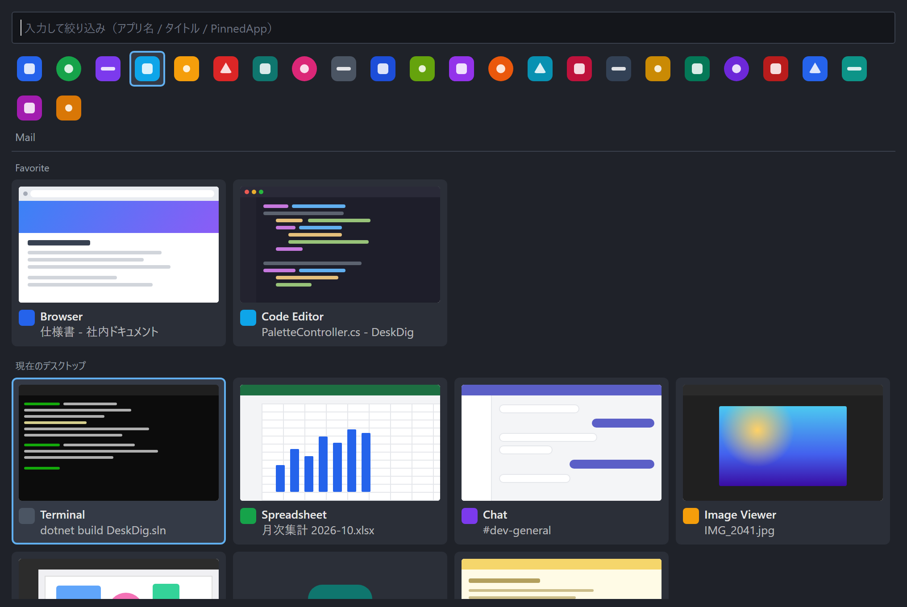

# DeskDig

散らばって埋もれたウインドウを、デスクトップのダブルクリックひとつで掘り出す Windows 用の常駐ツールです。

[紹介ページ](https://msdshsk.github.io/DeskDig/) · [ダウンロード](https://github.com/msdshsk/DeskDig/releases/latest) · [English summary](#english)



大きな高解像度ディスプレイで全画面化せずに作業していると、ウインドウは重なり合って埋もれていきます。DeskDig は、デスクトップの余白をダブルクリックするとマウスの手元にパレットを開き、開いているウインドウをライブサムネイル付きで一覧します。選べば前面に出ます。あわせて、ウインドウごとの配置の記録と復元、タスクバーに固定したアプリの起動を、同じパレット上で行えます。

## 機能

- **デスクトップのダブルクリックで開く**: デスクトップの余白をダブルクリックすると、その場所の近くにパレットが開きます。アイコンの上では反応しません。グローバルホットキー（既定は `Ctrl+Alt+Space`）でも開けます。
- **サムネイル付きの一覧**: 開いているウインドウを、ライブサムネイル・アプリアイコン・タイトル付きのタイルで並べます。タイル格子と縦リストを設定で切り替えられます。
- **往復しやすい並び順**: お気に入りに登録したウインドウが最上段、次にこのツールから最近アクティブ化した順、残りは OS の重なり順で並びます。他の仮想デスクトップにあるウインドウは区切りの下に表示され、選ぶとそのデスクトップへ切り替わります。
- **配置の記録と復元**: 右クリックメニューから「現在の配置を記録」すると、以後このツールからそのアプリを選ぶたびに、記録した位置とサイズに戻してから前面に出します。
- **タスクバー固定アプリのランチャー**: タスクバーに固定したアプリを、タスクバーと同じ順でパレット上段に一覧します。登録作業は不要で、Windows の固定状態をそのまま読み取ります。ストアアプリや MSIX 形式のアプリも含みます。既に開いているアプリは新しく起動せず、そのウインドウを前面に出します。設定で独自の並び順（ドラッグで変更）に切り替えることもできます。
- **横パネル（操作）**: 絞り込み欄の右の「操作」アイコンで、パレットの横に操作パネルが開きます。出力デバイスの切替・音量・ミュートをその場で行え、イヤホンの抜き差しも即座に反映されます。上段には環境変数ダイアログ、従来のサウンドダイアログ、ネットワーク、Bluetooth、ディスプレイ、バージョン情報へ一発で飛ぶボタンが並びます。ピン型のボタンをオンにすると、以後パレットと同時に開きます。
- **横パネル（情報）**: 「歯車」アイコンで、デバイス名・Windows のバージョンとビルド・CPU・メモリ・GPU の要約と「コピー」ボタン、設定画面への入口が開きます。人に PC の情報を伝えるときに使えます。
- **文字入力で絞り込み**: パレットを開いたまま文字を打つと、アプリ名・タイトル・固定アプリ名で絞り込みます。矢印キーと Enter でも選べます。

## 動作環境

- Windows 11（Windows 10 でも動作する見込みですが未検証です）
- .NET 9 デスクトップランタイム
- 管理者権限は不要です

## インストール

[GitHub Releases](https://github.com/msdshsk/DeskDig/releases/latest) から `DeskDig-Setup-<version>.exe` をダウンロードして実行します。管理者権限は不要で、ユーザー単位（`%LocalAppData%\Programs\DeskDig`）にインストールされます。.NET ランタイムは同梱されているので追加のインストールはありません。インストール時に「Windows サインイン時に自動起動」を選べます。アンインストールは Windows の「アプリ」から行えます。

zip で使いたい場合はポータブル版もあります。展開して `DeskDig.exe` を起動するだけで、インストーラーは使いません。

| 配布物 | 位置づけ |
|---|---|
| `DeskDig-Setup-<version>.exe` | 標準。インストーラー（ランタイム同梱、ユーザー単位） |
| `DeskDig-<version>-win-x64.zip` | ポータブル。.NET 9 デスクトップランタイムが入っている PC 向けで小さい |
| `DeskDig-<version>-win-x64-self-contained.zip` | ポータブル。ランタイム同梱の単一実行ファイル |

ポータブル版で自動起動をオンにした場合、登録されるのはその時点の exe の場所です。フォルダを移動しても、次に手動で起動したときに登録先を現在の場所へ書き直します。

## ビルドと実行

.NET 9 SDK が必要です。

```powershell
dotnet build DeskDig.sln
dotnet test tests/DeskDig.Core.Tests
dotnet run --project src/DeskDig
```

配布用のビルドは次のコマンドで `publish/` に出力されます。

```powershell
dotnet publish src/DeskDig -c Release -r win-x64 --self-contained false -o publish
```

起動するとタスクトレイに常駐します。トレイアイコンの右クリックメニューから設定画面を開いたり終了したりできます。二重に起動すると、新しい方は既存のインスタンスにパレットを開くよう伝えて終了します。

## 使い方

| 操作 | 動作 |
|---|---|
| デスクトップ余白をダブルクリック / `Ctrl+Alt+Space` | パレットを開く（開いていれば閉じる） |
| タイルをクリック / Enter | そのウインドウを前面に出す |
| 固定アプリのアイコンをクリック | 起動する。開いていればそのウインドウを前面に出す |
| 絞り込み欄右の「操作」「歯車」 | 横パネル（操作 / 情報）を開閉する。Esc は横パネル、もう一度でパレットを閉じる |
| 操作パネルの出力デバイスをクリック | 既定の出力先を切り替える（パレットは開いたまま） |
| 操作パネル上段のボタン | 環境変数、サウンドダイアログ、ネットワーク、Bluetooth、ディスプレイ、バージョン情報を開く |
| 文字を入力 | 一覧と固定アプリを絞り込む |
| 矢印キー / Tab | 選択を移動する / ウインドウ一覧と固定アプリの間を行き来する |
| タイルを右クリック | お気に入りに追加・解除、現在の配置を記録、配置を解除 |
| 固定アプリのアイコンをドラッグ | ランチャー内の並び順を変える（設定で「自分で並べ替える」を選んだ場合） |
| Esc / パレットの外をクリック | 閉じる |

設定画面では、トリガーの有効・無効、ホットキー、表示形式、格子の列数、サインイン時の自動起動を変更できます。記録済みの配置とお気に入りの一覧もここで編集・削除できます。配置にはタイトルの部分一致条件を追加でき、同じアプリの特定のウインドウだけを対象にできます。

設定は `%APPDATA%\DeskDig\` 配下の JSON ファイルに保存されます。

## 制限事項

- 仮想デスクトップは「現在のデスクトップ」と「他のデスクトップ」の二分表示までです。デスクトップ名は表示しません（非公開 API に依存しないための設計判断です。[ADR-0002](docs/adr/0002-virtual-desktop-public-api-only.md)）。
- ランチャーの一覧はタスクバーが内部に持つ固定一覧を読み取っています。その区切り形式は公開仕様ではないため、将来の Windows で読めなくなった場合は、従来型アプリだけをショートカットから表示する動作に退避します（[ADR-0003](docs/adr/0003-pinnedapp-source-is-taskband-registry.md)）。
- 配置の復元は、このツールからウインドウを選んだときにだけ行います。アプリの起動時や再起動時に自動で配置する機能はありません。
- 最小化中のウインドウはライブサムネイルが取得できないため、アプリアイコンで代替表示します。

## ドキュメント

- [仕様](docs/spec.md)
- [用語集](CONTEXT.md)
- [設計判断の記録](docs/adr/)

## ライセンス

[MIT License](LICENSE)

## English

DeskDig is a free, open-source window switcher for Windows 11. Double-click an empty spot on the desktop and a palette opens right under your mouse, listing every open window with a live thumbnail. Click one and it comes to the front. The palette also remembers where each window belongs and restores that placement on activation, and it lists your pinned taskbar apps so you can launch or switch to them from the same place. Type to filter, or use the arrow keys and Enter. A global hotkey (`Ctrl+Alt+Space` by default) works too.

Requires Windows 11 and the .NET 9 Desktop Runtime (a self-contained build is also provided). No installer, no admin rights. Settings live in `%APPDATA%\DeskDig\`.
